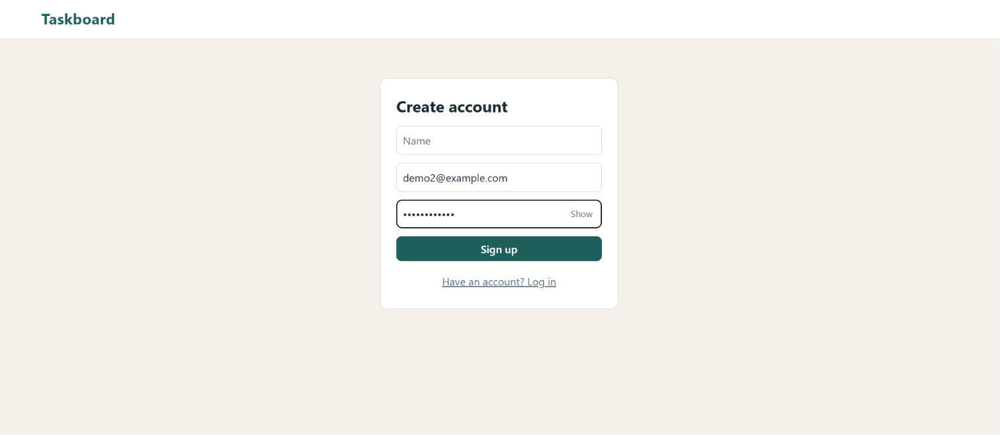
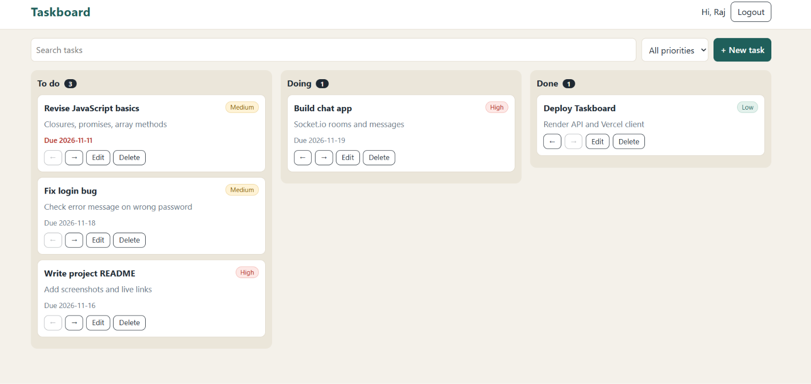
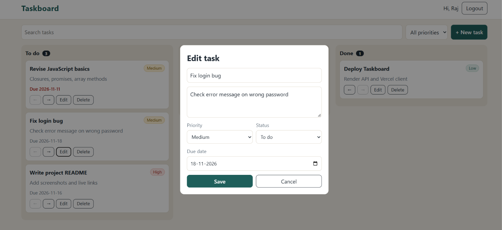

# Taskboard

A full-stack task tracker built with the MERN stack as a portfolio project. Each user signs up, logs in and manages their own tasks on a To do / Doing / Done board.

**Live demo:** https://task-tracker-tan-kappa.vercel.app

**API health check:** https://task-tracker-api-1viw.onrender.com/api/health

> **Demo project.** Sign up with any email, for example `demo@example.com`. No verification email is sent and nothing real is stored. Please don't enter personal data.

> The API runs on a free hosting tier, so the first request after a period of inactivity can take up to a minute while the server wakes up.

## Screenshots

| Sign up | Board | Edit task |
|---|---|---|
|  |  |  |

## Features

- Sign up and log in with JWT authentication and bcrypt-hashed passwords
- Show/hide password toggle on the login form
- Create, edit and delete tasks with title, details, priority and due date
- Three-column board (To do, Doing, Done); move tasks between columns with one click
- Search by title and filter by priority
- Overdue tasks are highlighted
- Every task belongs to a user: the API only returns and changes the logged-in user's tasks
- Responsive layout (columns stack on small screens)

## Tech stack

| Layer | Technology |
|---|---|
| Frontend | React (Vite), Context API, plain CSS |
| Backend | Node.js, Express |
| Database | MongoDB Atlas with Mongoose |
| Auth | JSON Web Tokens, bcryptjs |
| Hosting | Vercel (client), Render (server) |

## Run it locally

Requirements: Node.js and a free MongoDB Atlas cluster.

```bash
git clone https://github.com/vaishnavibt123-droid/task-tracker.git
cd task-tracker

# server
cd server
npm install
# create server/.env (see below), then:
npm run dev        # http://localhost:5001

# client (in a second terminal)
cd client
npm install
# create client/.env with VITE_API_URL=http://localhost:5001/api
npm run dev        # http://localhost:5173
```

`server/.env` (names only, never commit real values):

```
MONGO_URI=
JWT_SECRET=
PORT=5001
```

## API overview

| Method | Route | Description |
|---|---|---|
| GET | `/api/health` | Health check |
| POST | `/api/auth/signup` | Create an account |
| POST | `/api/auth/login` | Log in |
| GET | `/api/auth/me` | Current user (auth) |
| GET | `/api/tasks` | List my tasks (`q`, `priority` filters) (auth) |
| POST | `/api/tasks` | Create a task (auth) |
| PUT | `/api/tasks/:id` | Update a task (auth) |
| DELETE | `/api/tasks/:id` | Delete a task (auth) |

## Project structure

```
task-tracker/
  client/            React app (components, auth context, styles)
  server/
    models/          User, Task
    routes/          auth, tasks
    middleware/      JWT auth
```

## What I learned

- Building a REST API with Express and Mongoose, including input whitelisting and safe search
- Scoping every database query to the logged-in user so one user can never read or change another user's data
- Managing auth state in React with Context and handling loading and error states
- Deploying a split frontend and backend with environment variables

## Possible next steps

- Drag and drop between columns
- Due-date reminders
- Tests for the API routes
